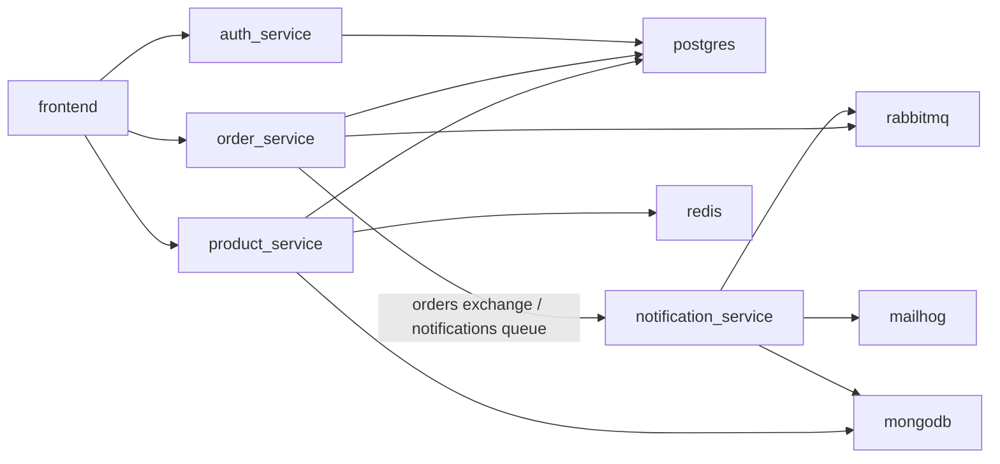

# Discovered application map

Captured: 2026-10-10T11:36:09.053045+00:00

Generated with `python -m chaos.map_application`. Optional `--overrides` supports manual corrections.

| Event | Publisher | Broker | Consumer |
| --- | --- | --- | --- |
| order.created | order-service | rabbitmq | notification-service |
| order.delivered | order-service | rabbitmq | notification-service |
| order.shipped | order-service | rabbitmq | notification-service |
| payment.confirmed | order-service | rabbitmq | notification-service |

Checkout stores the order in PostgreSQL, publishes a persistent RabbitMQ event,
then the notification consumer sends to local MailHog and records delivery in MongoDB.
Frontend browsing reads products and categories; Redis caches catalog results.

The graph describes declared dependencies and extracted event contracts.
Live acceptance separately verifies checkout, buffered delivery, and recovery.
